<picture>
  <source media="(prefers-color-scheme: dark)" srcset="assets/banner-dark.svg">
  <source media="(prefers-color-scheme: light)" srcset="assets/banner-light.svg">
  
</picture>

  
  
  

## About

Android developer from Delhi, India, with experience across apps, ROMs, kernels and scripts. I work at Primebook, building Android apps, system software and backend services.

I'm trying to get a little better every day. Off the clock, I take photos and I'm a defence enthusiast.

## What I've done

- Developed core apps for a custom Android-based OS.
- Built an MDM solution on top of Android's DevicePolicyManager.
- Built an MDM dashboard in Flutter Web.
- Started and maintain a Chromium-based browser, including background playback and device-management features.
- Wrote the scripts and SOPs the team uses to sync, manage and build Chromium.
- Built APIs for MDM and system services, plus internal tools.
- Built the early backend for a cloud PC offering, with Cashfree payments.
- Moved app-store storage to Cloudflare R2, saving over $2,000 a month.

## Stack

  <b>Android and mobile</b> 
  
  
  
  
  
  
   
  Also AOSP, Chromium, Hilt, Retrofit, Room, Coroutines, Flow, Bloc and GetIt.

  <b>Backend and cloud</b> 
  
  
  
  
  
  

  <b>Web</b> 
  
  
  

  <b>Tools</b> 
  
  
  
  
  
  

## Elsewhere

  
  
  
  

<picture>
  <source media="(prefers-color-scheme: dark)" srcset="assets/footer-dark.svg">
  <source media="(prefers-color-scheme: light)" srcset="assets/footer-light.svg">
  
</picture>
